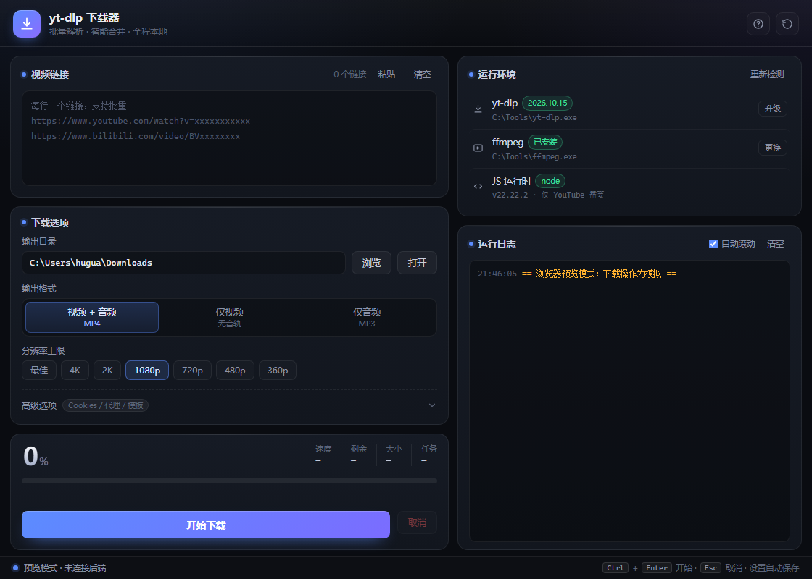

# yt-dlp 下载器

一个用 **Wails + Go** 写的 yt-dlp 图形外壳。Go 负责进程管理与配置，WebView2 负责界面，最终产物是 12 MB 的单文件 exe，运行时依赖系统的 WebView2 运行时。

最初是一个 Python/Tkinter 小工具（源码保留在 [`legacy/`](legacy/)），后来整体重写成了现在这个版本。



## 特性

- **批量下载**：一行一个链接，进度区显示 `当前/总数`
- **三种输出**：视频+音频合并 MP4、仅视频、仅音频转 MP3
- **分辨率上限**：最佳 / 4K / 2K / 1080p / 720p / 480p / 360p
- **实时进度**：百分比、速度、剩余时间、总大小、当前文件名
- **运行环境自检**：yt-dlp / ffmpeg / JS 运行时逐项检测，缺失时可在界面里直接指定路径
- **浏览器 Cookies**：复用 Chrome / Edge / Firefox 登录态，支持 Chrome 多 profile 自动识别，也支持 cookies.txt
- **代理**：`http://` 或 `socks5://`
- **配置持久化**：写入 exe 同目录的 `ytdlp_gui_config.json`，与旧版 Python GUI 的配置格式兼容
- **干净取消**：`taskkill /T` 连同 ffmpeg 子进程一起结束

## 直接使用

`build/bin/` 是绿色免安装目录，同目录放好依赖即可：

| 文件 | 必需 | 说明 |
|---|---|---|
| `yt-dlp-downloader.exe` | 是 | 主程序 |
| `yt-dlp.exe` | 是 | 下载核心，[官方 release](https://github.com/yt-dlp/yt-dlp/releases) |
| `ffmpeg.exe` | 建议 | 合并音视频、转 MP3，缺了无法用「视频+音频」模式 |

依赖不放在同目录也可以，在界面右侧「运行环境」里手动指定路径。

## 从源码构建

前置：Go 1.21+、[Wails CLI](https://wails.io/docs/gettingstarted/installation)、WebView2 运行时（Win10/11 一般自带）。

```bash
git clone https://github.com/fjnpzh/yt-dlp-downloader.git
cd yt-dlp-downloader

# 仓库不含二进制图标，先生成
python make_icon.py      # 需要 Pillow

wails build              # 产出 build/bin/yt-dlp-downloader.exe
wails dev                # 开发模式，支持热重载
```

## 项目结构

```
app.go                 配置读写、依赖探测、yt-dlp 进程管理、进度解析、事件推送
main.go                窗口尺寸与深色标题栏
frontend/src/          纯 HTML/CSS/JS，无前端构建步骤
build/                 图标与 Windows 清单
legacy/                原始 Python/Tkinter 版本，仅作对照
make_icon.py           生成 build/appicon.png 与 build/windows/icon.ico
```

前端没有框架也没有打包步骤。`window.go` 存在时调用真实后端；不存在时（比如直接用浏览器打开 `index.html`）自动进入 mock 预览模式，方便调样式。

## 关于 JS 运行时

yt-dlp 从 2025 年起把 YouTube 的 n-sig 解密交给了外部 JS 运行时。支持的运行时按优先级为 `deno > node > quickjs > bun`，**默认只启用 deno**。

所以程序会检测本机是否有 Node/Deno，有就自动追加 `--js-runtimes node`（否则 yt-dlp 即便装了 Node 也不会用）。这一项只影响 YouTube，其他站点没有也能正常下载，因此界面上标注为「可选」。

## 常见问题

**进度条不动？** 确认用的是本项目打包的 yt-dlp（需支持 `--newline`），并且日志里没有 `ERROR`。

**YouTube 提示需要登录 / 机器人验证？** 在「高级选项 → 浏览器 Cookies」里选择对应浏览器。Chrome 和 Edge 必须先完全退出（它们的 Cookie 数据库被占用），Firefox 一般不需要。

**合并失败？** 缺 ffmpeg。放到 exe 同目录，或在「运行环境」里指定。

## 声明

本项目只是 yt-dlp 的图形外壳，不包含任何下载能力，也不提供任何内容源。请遵守目标网站的服务条款与当地法律，仅下载你有权获取的内容。

## License

MIT
